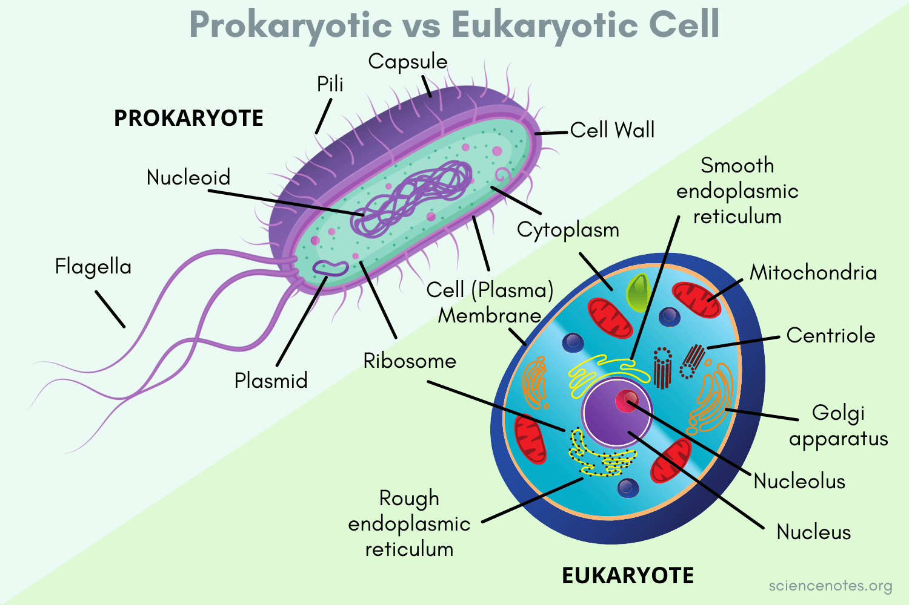
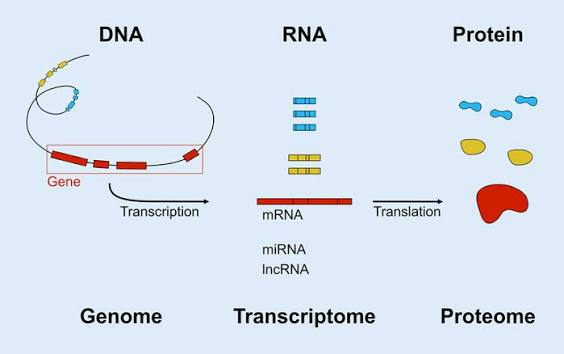
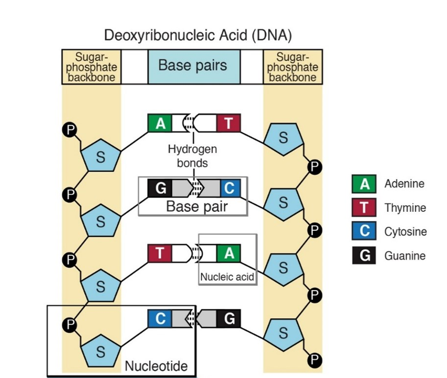
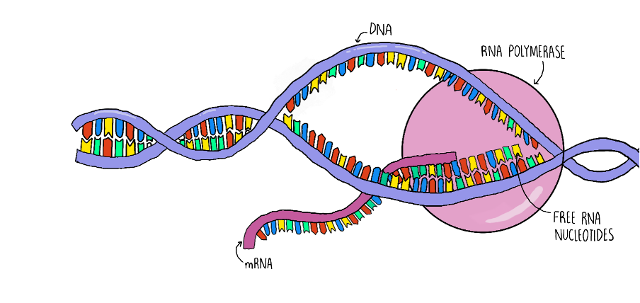
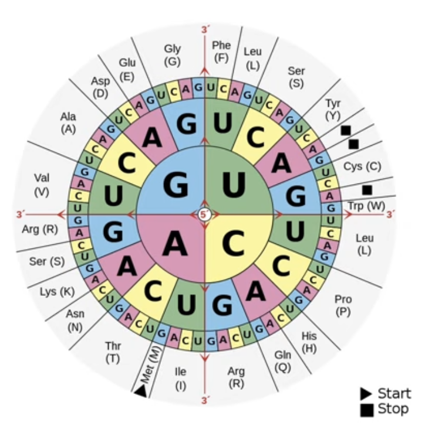
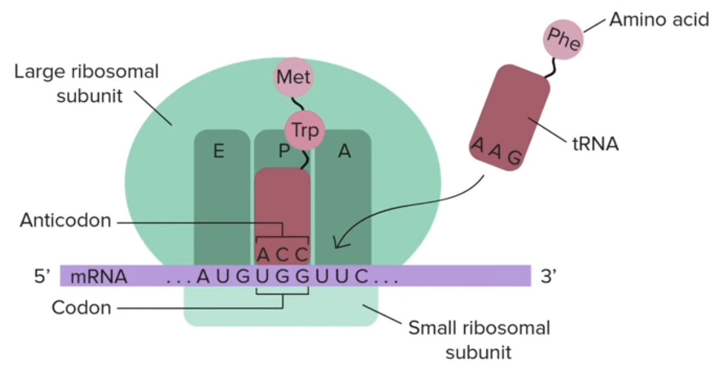
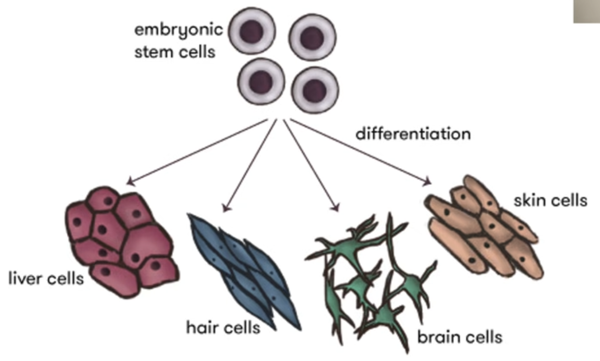

`Intro to Bioinformatics` playlist from https://www.youtube.com/@MikeSaintAntoine

Cells are the smallest unit of life that can function independently and they perform the key function of life including growth, metabolism and reproduction. They can be single-cell organisms like bacteria or they can be the building blocks of larger multisellular organisms like humans.

## proaryotic and ukareotic

Ukareotics have membranebound organels and that includes the nucleus. Nucleus is there the DNA is contained in. And proaryotic cells are generally simpler and don't have membranebound organels including the nucleus. They still have DNA but they are free floating in the cell.

Proaryotic features:

- single-celled
- simple structure- no nucelus
- typically smaller than ukareotic
- often have external features; flagella and pili for movement

Ukareotic features:

- complex structure
- can be single-celled: protists, yeast
- can be part of multi-cellular organisms

#### Nuleus

- Control center of the cell
- Contains the DNA which are organized into chromosomes
- Contains Nucleolus, where ribosomal RNA (rRNA) and proteins are combined to produce ribosomal subunits

  

Found in both prokaryotes and eukaryotes (not membrane-bound), responsible for protein assembly from amino acids based on the messanger RNA sequence (mRNA). The put together proteins based on the information found on mRNA (translation).

Endoplasmic Reticulum (ER): The rough ER is lined with ribosomes and assists in protein folding/processing; the smooth ER is involved in lipid synthesis.

Golgi Body: Modifies and packages proteins and lipids.

Mitochondria: The powerhouse of the cell, generating ATP via cellular respiration and containing its own DNA.

information is stored in stretches of of the DNA called genes. And that information can be used to produce strands of messenger RNA that are then used to put together proteins out of amino acids. And then the proteins actually do a lot of the actual work of the cell. They're involved in like signaling, cell cycle control, stimulus response, metabolism, regulating various cellular processes.

This process where information flows from genes in the DNA to the mRNA to the proteins is called the central dogma of molecular biology. This process uh is is also called gene expression. So if a gene is being expressed that means the information in the DNA is being used to actually create something that is physically floating around in the cell and performing some function.

Different gene expression patterns could be signs of like interesting biological differences between cells. you could ask how the expression of a gene differs between different kinds of cells. For example, maybe a gene has higher or lower expression in cancerous lung cells compared to healthy lung cells.

The process where mRNA is created from the information in the in the DNA is called transcription. The process where the protein is created from the mRNA is called translation.

the mRNA is produced produced from from the gene. these strands kind of float around in the cell and exist in the cell for a bit and they also break down over time and we can model the production and the degradation or the breakdown of them as both being random stochastic processes and same with the proteins. The proteins usually are more stable than the mRNA. They're produced and they kind of float around in the cell a bit and also break down and disappear over time. So again the production and the degradation or the breakdown of the protein can also be modeled as a random stochcastic process.

  

organisms have many different genes that produce different proteins that do different things. humans for example have about 20,000 or so genes and different genes produce different types of strands of messenger RNA which produce different proteins.

We talked before about different functions a protein can have can be involved in metabolism or signaling or stimulus response. One of the possible functions that a protein can have is actually to regulate the expression of other genes or even of their own gene. These are called transcription factors. These transcription factor proteins can bind to the DNA close to the site of another gene and then making it easier or harder for mRNA to be produced from that second gene. We call this, gene regulation, where the protein from one gene can regulate the expression of another gene or of itself. These can form pretty complex networks where you can have entire networks of genes, all like regulating each other basically. when these networks go wrong or like something goes ary in them that can lead to diseases like cancer if things are not being regulated properly.

DNA is the molecule that stores the information that's made up of four bases.

- Adinine
- Thymine
- Cytosine
- Guanine

And the molecule is double stranded and there's a base on each one of the strands and the bases on the two strands are complmentary in the sense that A and T go together and C and G go together. These sequences are what encode the information that's used to make the messenger RNA.

Messenger RNA (mRNA) is produced from DNA in a process called transcription. Like DNA, mRNA is made up of nucleotides containing specific bases. Three of these bases—adenine (A), guanine (G), and cytosine (C)—are the same as those found in DNA. However, instead of thymine (T), mRNA contains uracil (U). Additionally, mRNA is single-stranded, whereas DNA is double-stranded.

The transcription process begins when an enzyme called RNA polymerase binds to the DNA, unzipping the double helix. The enzyme moves along one of the DNA strands, reading the sequence and assembling a string of mRNA bases that are complementary to the DNA template.

For example, if the RNA polymerase encounters a guanine (G) on the DNA strand, it adds a cytosine (C) nucleotide to the mRNA. If it sees an adenine (A), it adds a uracil (U). By creating this complementary sequence, the cell accurately copies and retains the genetic information stored within the original DNA sequence.

It's called a um nucleic acid. Um, and yeah, both mRNA and DNA are nucleic acids. And yeah, nucleic acid basically just means um it's made up of um nucleotides. It's like a like a uh like a string of nucleotides. Um remember each each nucleotide has um has these um bases that we represent with these letters. Um the DNA has base pairs meaning it has um like two bases and the uh the messenger RNA is single stranded so it only has um it only has one one base in each position. Um and yeah, again there's four bases.

mRNA is um single stranded and it's um it's one of several types of RNA. So um yeah, messenger RNA or mRNA is one of of um several different types of RNA. There are different types of RNA that do different things in the cell.

Translation is the process by which amino acids are strung together based on the information in messenger RNA (mRNA) to ultimately form a functional, folded protein.

As discussed, mRNA acts as a complementary copy of the nucleotide sequence in DNA, retaining that genetic information. This mRNA sequence can be thought of in terms of nucleotide triplets, known as codons.

During translation, the mRNA strand attaches to a ribosome, where the genetic code is read codon by codon. Each triplet specifies a particular amino acid, which is added to the growing chain until a complete polypeptide is formed and folded into a working protein.

Proteins are chains of amino acids strung together based on the information carried by mRNA, which serves as an intermediate carrier of the genetic code from DNA. Following translation, these amino acid chains undergo further processing and folding to achieve their final, functional three-dimensional structures.

Different types of proteins can be produced from the same gene. One major way this occurs is through alternative splicing, a process where the mRNA transcript is cut and pieced back together in different combinations before translation, resulting in varied amino acid sequences and distinct protein isoforms.

Gene expression can also be regulated by the three-dimensional structure of the DNA itself. In complex organisms like humans, the DNA molecule is organized into complex 3D structures known as chromosomes (we have 23 pairs).

Epigenetics refers to the ways gene expression is regulated based on this 3D structure and organization of DNA. For example, regulation can depend on how tightly or loosely DNA is wrapped around proteins called histones, which directly determines whether specific genes are accessible for transcription.

The double-stranded DNA sequence is wrapped either tightly or loosely around histone proteins. DNA that is loosely wrapped, or located in the regions between histones, remains accessible for RNA polymerase to bind and transcribe.

Conversely, DNA that is tightly coiled around histones is inaccessible. Any genes located within these tightly packed regions are effectively silenced, preventing them from being transcribed into mRNA or expressed as proteins.

Epigenetics plays a crucial role in cell differentiation. Almost all cells in the human body share the exact same DNA sequence—with a few exceptions, such as gametes, certain mature blood cells that lack DNA, or cells with random mutations.

This raises a fundamental question: if all these cells have the same genetic code, how do they develop into specialized cells with completely different biological roles, functions, and qualities (such as liver cells, brain cells, skin cells, and hair cells)?

The answer lies in epigenetics. Epigenetic regulation allows cells with identical DNA to maintain vastly different gene expression profiles, turning specific sets of genes on or off to create and sustain specialized cell types.

Even though liver, hair, brain, and skin cells share the exact same DNA sequence, their unique epigenetic profiles dictate which genes are expressed and at what levels. This leads to the production of distinct sets of proteins, creating the specific biological characteristics and functions of each cell type.

During development, uncommitted embryonic stem cells undergo cell differentiation (or cell fate determination) to transform from general, unspecialized cells into specialized tissue types. Through complex regulatory mechanisms, these cells establish and maintain distinct epigenetic profiles, ensuring that liver cells act like liver cells, neurons act like neurons, and skin cells act like skin cells. It is a remarkable system of biological programming.

In a typical gene expression dataset, such as an RNA-seq count matrix, the data is organized as a spreadsheet where the rows correspond to individual genes or transcripts and the columns correspond to different biological samples, conditions, or single cells. Each numeric value in this matrix tells us how many cDNA fragments or sequencing reads mapped back to that particular gene in that specific sample. This gives us a massive, high-throughput snapshot of the mRNA content across different conditions.

When trying to measure gene expression, researchers typically measure mRNA rather than proteins, even though proteins are the actual functional workhorses of the cell that carry out most cellular tasks. The main reason for this approach is technical feasibility. Because RNA consists of nucleic acids, it can be easily amplified using PCR and sequenced in parallel at a massive scale using next-generation sequencing. Proteins, being composed of amino acids, cannot be copied or amplified in the same way. While mass spectrometry-based proteomics has advanced significantly, capturing the entire proteome of a cell with the same depth, dynamic range, and ease as RNA-seq remains technically much more demanding, making transcriptomics an invaluable high-throughput proxy for cellular activity.

That assumption is one of the most foundational and pragmatic trade-offs in molecular biology and bioinformatics. When researchers use transcriptomics as a proxy for proteomics, they are leaning on the technical convenience of mRNA measurement while acknowledging that the biological reality is far more complex. In many stable, steady-state systems, or for highly abundant housekeeping genes, the correlation between mRNA and protein levels is reasonably strong, which allows researchers to draw meaningful conclusions about cellular activity without needing to run difficult proteomics experiments for every single sample.

However, that correlation frequently breaks down, and understanding those discrepancies is a major area of active computational and biological research. One primary reason for the mismatch is translational control, where cells can have abundant mRNA transcripts sitting in the cytoplasm that are actively repressed by microRNAs or RNA-binding proteins, meaning those transcripts are never actually translated into proteins. Conversely, some mRNAs are translated at exceptionally high rates from very few transcripts, producing a large amount of protein from a surprisingly small pool of mRNA.

Another major factor is protein half-life and degradation rates. A gene might have high mRNA expression at one moment, but if the resulting protein is unstable and degrades rapidly, the actual protein level will remain low. On the flip side, some proteins are extremely stable, persisting long after the mRNA that encoded them has been degraded and cleared from the cell. Factors like post-translational modifications, spatial compartmentalization, and rapid cell stress responses further decouple the transcriptome from the proteome, which is why multi-omics integration and predictive modeling of translation efficiency remain such vibrant frontiers in computational biology.

Several different experimental techniques can produce this gene-by-sample matrix format, each capturing cellular information at a different resolution. The most common traditional approach is bulk RNA sequencing, or bulk RNA-seq. In a bulk RNA-seq experiment, each column represents a sample composed of millions of cells pooled together, meaning the resulting measurement reflects the average mRNA content across that entire heterogeneous population of cells.

In contrast, single-cell RNA sequencing, or scRNA-seq, is a more recent methodology where every sample corresponds to a single, isolated cell. This powerful technique allows researchers to quantify the mRNA content of individual cells rather than relying on an aggregate average, uncovering cellular heterogeneity and distinct cell types that would otherwise be completely washed out in a bulk mixture.

An older technology known as DNA microarrays also produces a similar gene-by-sample matrix format, though the underlying experimental chemistry and the resulting numbers differ significantly from sequencing methods. Instead of counting discrete cDNA fragments that yield raw integer read counts, microarrays use hybridization and measure fluorescence intensity, resulting in continuous decimal numbers. Despite these differences in how the values are generated, the overall biological interpretation remains very similar, where higher numbers indicate greater relative mRNA abundance for a given gene and lower numbers indicate less expression.
