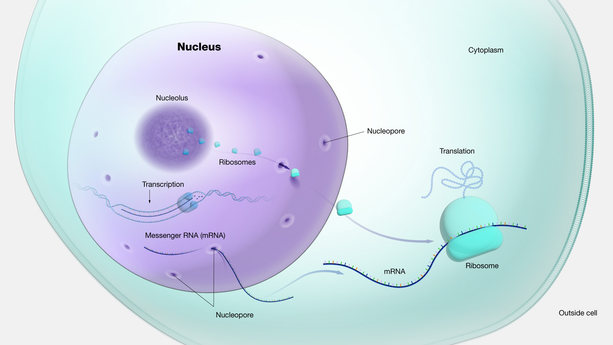

`Intro to Bioinformatics` playlist from https://www.youtube.com/@MikeSaintAntoine

Cells are the smallest unit of life that can function independently and they perform the key function of life including growth, metabolism and reproduction. They can be single-cell organisms like bacteria or they can be the building blocks of larger multisellular organisms like humans.

## proaryotic and ukareotic

Ukareotics have membranebound organels and that includes the nucleus. Nucleus is there the DNA is contained in. And proaryotic cells are generally simpler and don't have membranebound organels including the nucleus. They still have DNA but they are free floating in the cell.

Proaryotic features:

- single-celled
- simple structure- no nucelus
- typically smaller than ukareotic
- often have external features; flagella and pili for movement

Ukareotic features:

- complex structure
- can be single-celled: protists, yeast
- can be part of multi-cellular organisms

#### Nuleus

- Control center of the cell
- Contains the DNA which are organized into chromosomes
- Contains Nucleolus, where ribosomal RNA (rRNA) and proteins are combined to produce ribosomal subunits

  

Found in both prokaryotes and eukaryotes (not membrane-bound), responsible for protein assembly from amino acids based on the messanger RNA sequence (mRNA). The put together proteins based on the information found on mRNA (translation).

Endoplasmic Reticulum (ER): The rough ER is lined with ribosomes and assists in protein folding/processing; the smooth ER is involved in lipid synthesis.

Golgi Body: Modifies and packages proteins and lipids.

Mitochondria: The powerhouse of the cell, generating ATP via cellular respiration and containing its own DNA.
